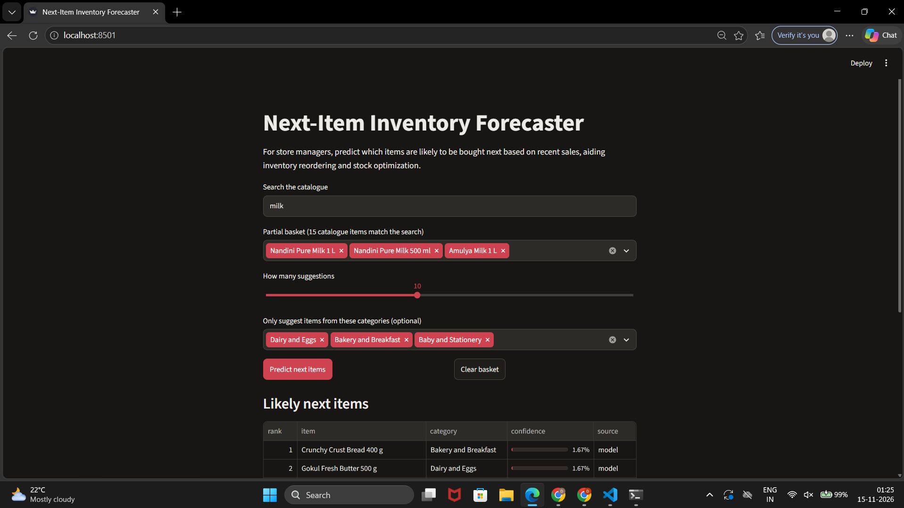

# Next-Item Inventory Forecaster

Type in part of a shopping basket and get the items most likely to be bought next with it, so a store manager can
see what sells together and reorder the right stock. The predictions come from a small language model
(SmolLM2-135M) whose pretraining was continued on mock sales baskets written as text, `Basket: item; item; item`.
It completes a basket the way it would complete a sentence. A best-seller (frequency) baseline is there to compare
against and to fall back on.


<!-- Screenshot placeholder: run the app and save a screenshot as docs/screenshot.png -->

## What it does

- **Data** (`app/core.py`, `scripts/prepare_data.py`): 100,000 mock baskets from a 1,000-SKU grocery shop with 32
  planted "bought together" itemsets, from the drill's generator (`thilimarketbasket`, seed 0). Each basket is
  written once per line, each SKU once, in a shuffled order, and 5% are held out.
- **Training** (`app/train.py`, `scripts/train.py`): continued pretraining with the plain next-token loss, padding
  masked out, warmup then cosine learning rate, and gradient accumulation over micro-batches. Ported from the drill
  to PyTorch on a CPU.
- **Prediction** (`core.predict_next`): the visible basket becomes the prompt `Basket: a; b;`. The model writes 20
  continuations one token at a time (temperature 1.0, stopping at `;`). Each continuation is a vote for the
  catalogue item it names; items already in the basket and made-up names are dropped. Items are ranked by votes,
  and confidence is the share of samples that named the item. Short lists are filled from the best sellers and
  marked `baseline`. It takes about 1 s on a laptop CPU.
- **App** (`app/main.py`): search the catalogue, pick the basket, choose how many suggestions, optionally limit them
  to some categories, press **Predict next items**, read the ranked table (item, category, confidence, source), and
  press **Clear basket** to start again. Without a model it says so and shows the best sellers instead.
- **Evaluation** (`scripts/evaluate.py`): held-out baskets with one item hidden. It reports hits@1/5/10 for the
  model against the frequency baseline and item-to-item counting, with bootstrap 95% ranges.

## Setup

You need Python 3.12 (3.13 also works) and git. The CPU build of PyTorch is pulled in by `requirements.txt`.

**Windows (PowerShell or Git Bash)**

```bash
py -3.12 -m venv .venv
.venv/Scripts/python -m pip install -r requirements.txt
```

**Linux / macOS**

```bash
python3.12 -m venv .venv && source .venv/bin/activate
pip install -r requirements.txt
```

No `.env` is needed. The starter's optional LLM chat helper (`app/llm.py`) isn't used by this project.

## Get a model

The app and the evaluation read the model from `MODEL_DIR` (default `models/forecaster/`, git-ignored). Use one of:

1. **Copy the drill's checkpoint** (SmolLM2-135M after 100 steps of 16 baskets):
   ```bash
   mkdir -p models/forecaster
   cp <drill repo>/work/checkpoints/baskets-100x16/{config.json,generation_config.json,model.safetensors,tokenizer.json,tokenizer_config.json} models/forecaster/
   ```
2. **Train it yourself.** This downloads SmolLM2-135M from Hugging Face once:
   ```bash
   python scripts/prepare_data.py                                  # optional: writes data/train.txt and data/val.txt
   python scripts/train.py --steps 100 --batch 16 --out models/forecaster
   python scripts/train.py --steps 5 --out models/proof-5          # quick end-to-end check
   ```
   The 5-step check ran on a Windows laptop CPU: held-out loss went 3.509 → 2.126 in 2.0 min, and the result was
   saved and reloaded. `--micro-batch` (default 4) only changes memory use, not the gradient. A micro-batch of 8 ran
   out of memory with ~5 GB of RAM free.

## Run it

```bash
streamlit run app/main.py      # opens http://localhost:8501
pytest                         # 28 tests, ~15 s, no model or download needed
python scripts/evaluate.py --cases 200
```

The tests use a tiny randomly-initialised Llama, fake samplers and Streamlit's `AppTest`, so they run on GitHub
Actions (Ubuntu, Python 3.12, CPU) without the trained model.

## Results

`python scripts/evaluate.py --cases 200` hides one item from each of 200 held-out baskets (the drill's cases) and
checks whether it appears in each method's top N suggestions. Full report: [results/eval.md](results/eval.md).
**200 cases were used to save time** (a 400-case run was stopped), so one case moves a hit rate by 0.005.

| method (200 cases) | hits@1 | hits@5 | hits@10 |
|---|---|---|---|
| model (100-step SmolLM2-135M, 20 samples) | 0.025 | 0.060 | 0.075 |
| frequency baseline (best sellers) | 0.005 | 0.080 | 0.120 |
| item-to-item counting | 0.135 | 0.170 | 0.200 |

Model minus frequency baseline: hits@1 +0.020 (95% range +0.000 to +0.045), hits@10 -0.045 (-0.090 to +0.005).
The model's first guess beats the best sellers' first guess slightly, but neither difference is clearly real
with 200 cases. Plain item-to-item counting is clearly better than the 100-step model at every N (hits@10 -0.125,
-0.180 to -0.070), which matches the drill's finding that counting is the bar to beat after such short training.

## Honest limits

- **Synthetic shop.** The baskets are generated, with 32 planted itemsets. The results describe this toy shop, not a
  real store.
- **Short CPU training.** The model saw 1,600 baskets (100 steps of 16), about 2% of one pass over the data. The
  drill's course ran 8× longer. Longer training would very likely help, but at ~3–24 s per step on a laptop CPU it
  wasn't done here.
- **Generation-based ranking.** The ranking comes from only 20 samples, so most items get one vote and confidences
  are coarse (multiples of 5%). The model also sometimes writes names that aren't in the catalogue; those votes are
  lost. Scoring every catalogue item directly, as the drill did, ranks better but takes ~30 s per basket on this CPU.
- **Small evaluation.** 200 cases were used to save time, so differences of a few points are within noise; see the
  95% ranges.

## Milestones

- [x] **1. Prepare mock sales transaction data as sequences of SKUs.**
- [x] **2. Continue pretrain a small language model on these SKU sequences.**
- [x] **3. Implement next-item prediction logic using the trained model.**
- [x] **4. Build a Streamlit UI to input a partial basket and display predictions.**
- [x] **5. Evaluate model performance against a simple baseline.**

Stretch ideas:

- [x] Filter predicted next items by product category.
- [x] A 'clear basket' button in the Streamlit UI to start new predictions.
- [x] A 'confidence score' alongside each predicted item.
